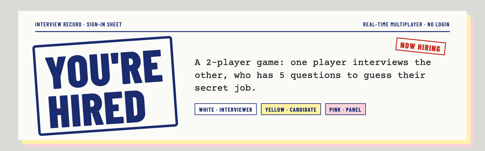
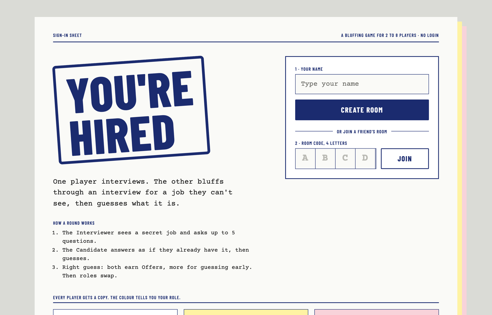
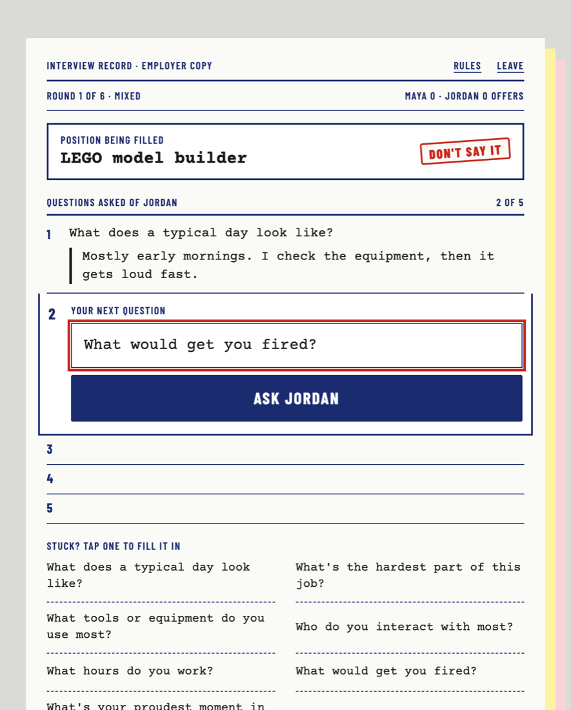
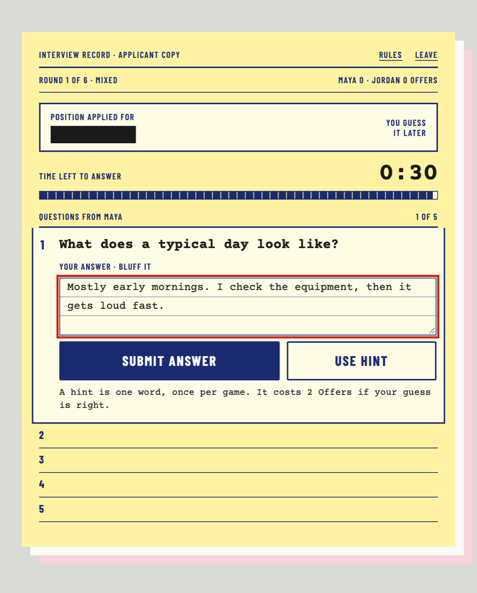
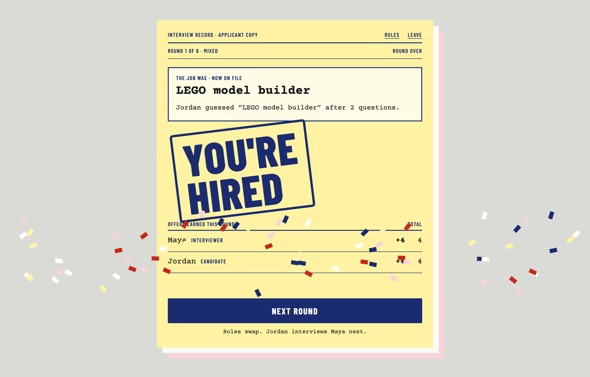

<p align="center"></p>

<p align="center">
  
  
  
  
  
  
</p>

<p align="center">
  <a href="#how-to-play">How to play</a> ·
  <a href="#scoring">Scoring</a> ·
  <a href="#screens">Screens</a> ·
  <a href="#run-it-yourself">Run it yourself</a> ·
  <a href="#how-it-works">How it works</a> ·
  <a href="#security">Security</a>
</p>

You're Hired is a real-time party game for two or more people on their own phones or laptops. One player is the **Interviewer** and can see a secret job, like *wedding DJ* or *TA for a discrete math class*. The other player is the **Candidate**, who can't see it. The Candidate answers every question as if they already have the job, then guesses what the job is. Roles swap every round.

Built for the Handshake "Create a Multiplayer Game" challenge. Play it at **<https://youre-hired-production.up.railway.app>**: one person creates a room and the other joins with the 4-letter code.

<p align="center"></p>

## How to play

1. One player creates a room and becomes the **Hiring Manager** (the host). Everyone else joins with the 4-letter room code. No accounts, nothing to install.
2. Each round, one player is the **Interviewer** and one is the **Candidate**. With more than two players, everyone else sits on the **Panel** and watches.
3. The Interviewer sees the secret job and asks up to **5 questions**, either typed or picked from a list of 15. A question that names the job or an obvious keyword is blocked.
4. The Candidate has **30 seconds** per answer and bluffs as if they already have the job. They can guess at any point after the first answer.
5. Roles swap every round. After the last round, whoever has the most **Offers** wins.

Every player's screen is a paper copy in a different colour: **white** for the Interviewer, **yellow** for the Candidate, **pink** for the Panel.

## Scoring

| Outcome | Interviewer | Candidate |
| --- | --- | --- |
| Right guess after *n* questions | 6 − *n* Offers (at least 1) | 6 − *n* Offers (at least 1) |
| Right guess after using the hint | same as above | 2 fewer (at least 1) |
| Wrong guess, or time runs out | 2 Offers | 0 |

Because a right guess pays both players, the Interviewer wants to ask good questions. The **hint** is a one-word clue the Candidate can use once per game.

## Screens

<table>
  <tr>
    <td width="50%"></td>
    <td width="50%"></td>
  </tr>
  <tr>
    <td align="center"><b>Interviewer</b> sees the job and asks</td>
    <td align="center"><b>Candidate</b> bluffs against the clock</td>
  </tr>
</table>

<p align="center"></p>

## Game options

- **Difficulty:** Easy (40 everyday jobs such as firefighter or barista), Hard (40 odd ones such as professional mattress tester) or Mixed.
- **Rounds:** 2, 4, 6 or 8. The default is 6, so in a 2-player game each person interviews 3 times.
- **Reconnects:** reload the page or lose signal and you rejoin the same room and role. The timer pauses while an active player is away.

## Run it yourself

You need Node.js 20 or newer.

```bash
git clone https://github.com/Sathvik609/youre-hired.git
cd youre-hired
npm install
npm start          # http://localhost:3000
npm test           # game rules, a full 2-player round, and malformed-input checks
```

To play both sides on one computer, open `http://localhost:3000` in a normal window and in a private window. Each window keeps its own session.

## How it works

```
public/        index.html, app.js, styles.css   plain HTML, CSS and JS, no build step
server.js      Express + Socket.IO              rooms, turns, timers and reconnects, all in memory
gameLogic.js   rules                            guess matching, banned words, payouts, role rotation
jobs.js        content                          80 jobs, each with aliases, banned words and a hint
```

- The **server is the referee**. It holds the secret job, runs every timer and scores each round. Each player is sent only what their role may see, so the Candidate's browser never receives the job title.
- Each player gets a random session token, saved in the browser. On reload, the token puts them back in the same seat.
- There is no database. Empty rooms are cleared after 10 minutes.
- Deployed on Railway from `main`. The server reads `PORT` from the environment and binds `0.0.0.0`.

## Security

The game has no accounts, stores no personal data and keeps nothing on disk. It still runs on a public URL, so the server:

- checks every message it receives: anything that isn't the expected shape is rejected, and an error in one event can't crash the server
- caps messages at 16 KB, connections per IP, new rooms per IP per minute, events per second per connection, and the total number of rooms
- escapes all player text before showing it, and sends a strict Content-Security-Policy plus `nosniff`, `frame-ancestors 'none'` and `no-referrer` headers

Found a problem? See [SECURITY.md](SECURITY.md).

## Behind the build

The rules were written first, the game was built with ChatGPT and finished with Claude Code, and every bug found in two-browser playtests is in [docs/bug-log.md](docs/bug-log.md). The prompts used are in [docs/chatgpt-prompts.md](docs/chatgpt-prompts.md).
